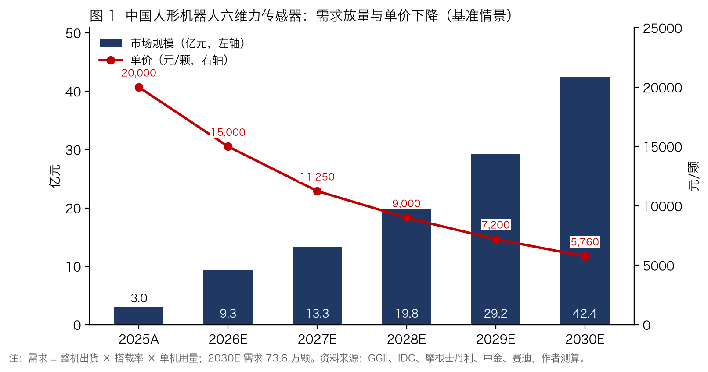
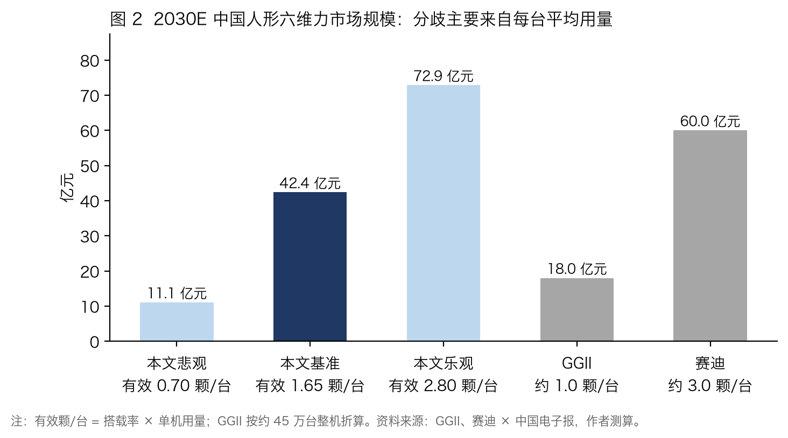
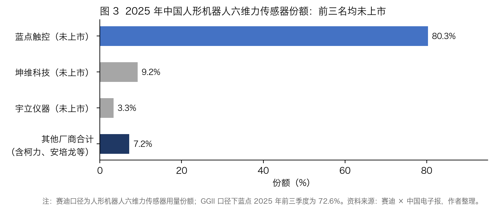
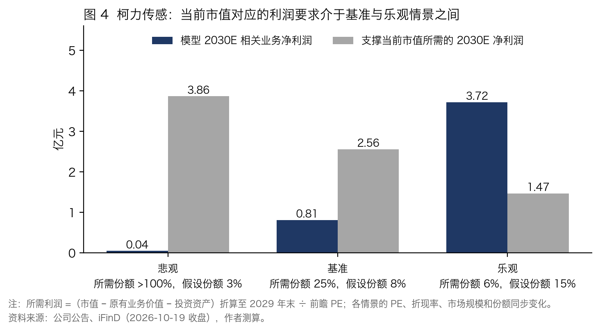
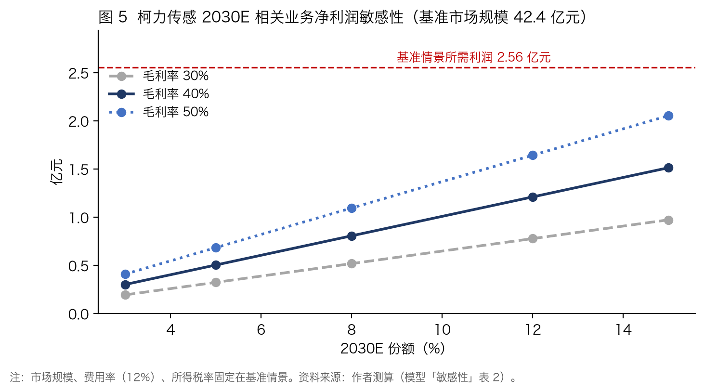

# 人形机器人六维力传感器专题：需求增长与降价并行，上市公司兑现取决于客户突破

**报告日期：** 2026-10-20｜**数据截止：** 2026-10-19｜**作者：邓兴华**  
**配套文件：** `六维力传感器_模型.xlsx`（假设、ROI、需求情景、收入桥、利润与估值、敏感性、数据底稿）；`图表/`

---

## 核心观点

**国内人形六维力市场 2030 年基准约 42 亿元，规模主要取决于每台平均用量。** 本文按"整机出货 × 搭载率 × 单机用量 × 单价"测算。基准情景下，2030 年中国人形机器人出货 44.6 万台，搭载率 55%，搭载机型每台 3 颗，对应需求约 73.6 万颗；单价从 2025 年约 2 万元/颗降至 5,760 元/颗，市场规模约 42.4 亿元（悲观 11.1 亿元，乐观 72.9 亿元）。GGII 与赛迪对 2030 年的预测相差 3.3 倍，分歧同样集中在每台平均用量。需求还受客户经济性约束：以汽车工厂料箱搬运为例，中性参数下人形机器人尚不能回本，2026–2027 年采购仍以示范和战略采购为主。

**价值量高，不等于上市供应商利润高。** 据赛迪统计，2025 年人形六维力前三名合计份额 92.8%，蓝点触控、坤维科技、宇立仪器均未上市，上市公司与其他厂商合计约 7.2%。头部厂商规划产能扩张较快，整机厂持续压降 BOM，部分整机厂已开始自研。若相关业务要维持 40% 的毛利率，2030 年单颗成本需降至约 3,460 元，比头部厂商目前宣传的量产成本低约 30%–65%。

**柯力传感进度领先，但当前市值要求的份额明显高于本文基准。** 柯力 2026 年上半年机器人力学传感器销量超过 2,000 只，但该口径包含关节力矩传感器和非人形应用；已披露的人形批量客户开普勒为其参股公司。基准情景下，柯力 2030 年人形六维力相关收入约 3.39 亿元，净利润约 0.81 亿元。按 2026-10-19 收盘市值反推，扣除原有业务价值和投资资产后，市场隐含的新业务价值约 56.5 亿元，对应 2030 年约 25% 的份额，高于本文基准的 8%，介于基准与乐观情景之间。能否兑现，关键看柯力能否在独立的头部整机厂取得批量订单。

| 公司           | 业务进展                     | 2030E 基准净利润（亿元） | 当前市值隐含 2030E 份额 / 本文基准 | 跟踪优先级 | 下一个验证点                |
| ------------ | ------------------------ | --------------- | ---------------------- | ----- | --------------------- |
| 柯力传感（603662） | 小批量向批量过渡；人形批量客户为参股公司     | 0.81            | 25% / 8%               | 重点研究  | 独立头部整机厂批量订单；六维力出货单独披露 |
| 安培龙（301413）  | 2026-09 披露部分客户批量交付，规模未披露 | 0.50            | 20% / 5%               | 持续跟踪  | 年报是否拆分力传感器收入；定增产线投产   |
| 东华测试（300354） | 小批量试制，尚无人形订单             | 0.10            | 1% / 1%                | 证据不足  | 首个人形客户订单              |

资料来源：公司公告、赛迪、GGII、iFinD，作者测算。注：隐含份额按基准情景的估值倍数、折现率和市场规模计算，方法见第 4 部分。

**主要风险：** 主流机型改用电流估计或足底传感，搭载率低于预期；价格下降快于成本下降；整机厂自研六维力；估值倍数和折现率假设变化。

---

## 1. 需求：市场规模取决于每台用量，客户经济性仍待改善

### 1.1 研究范围

本文研究中国市场的人形机器人末端六维力传感器，即装在腕部或踝部、同时测量三个方向的力和三个方向的力矩的传感器模组，按"颗"计量。机器人形态包括双足和轮式底盘的全尺寸人形机器人：目前明确搭载六维力的工业机型中，优必选 Walker S2 为双足，智元 A2-W 和银河通用 G1 为轮式，只统计双足会漏掉相当一部分需求，也与第三方出货统计口径不一致。

| 项目    | 本文口径                              | 不包含                              |
| ----- | --------------------------------- | -------------------------------- |
| 机器人形态 | 全尺寸人形机器人（双足、轮式），出货口径跟随 GGII / IDC | 1 米以下消费级人形、四足、协作机器人、工业机器人        |
| 产品    | 腕部、踝部六维力/力矩传感器                    | 关节扭矩传感器、触觉阵列、一维/三维力传感器、灵巧手指尖力传感器 |
| 地域    | 国内整机厂需求、国内供应商、A 股/港股上市公司          | 海外整机厂与海外供应商（进口价格只作对照）            |
| 时间    | 2025 年实际，2026–2030 年预测            | 2030 年以后的远期空间                    |

### 1.2 客户经济性：汽车工厂搬运在中性参数下尚不能回本

**在中性参数下，汽车工厂料箱搬运的年运维成本已超过可节省的人工成本。** 本文选取国内汽车整车和零部件工厂的线边料箱搬运、上下料作为样本任务。这是国内人形机器人工业实训最集中的场景，优必选、小米、乐聚等均有公开案例，也是需要腕部六维力完成力控抓放的任务。按初始投入 50 万元、两班运行、速度为人工的 45%、成功率 98%、一名工程师照看四台计算，一台机器人每年等效替代约 0.75 名工人，节省人工约 7.87 万元；维保、工程师照看和能耗每年新增约 8.97 万元，年净节省为负，无法回本。在其他参数不变的情况下，要在 5 年内回本，速度需达到人工的 108%。

| 情形（其他参数取中性值）                          | 回本期     |
| ------------------------------------- | ------- |
| 中性参数                                  | 无法回本    |
| 只把初始投入降到车企期望的 25 万元                   | 约 18 年  |
| 只把速度提高到优必选 2027 年目标的 80%              | 约 10 年  |
| 投入降到 25 万元，同时速度提高到 80%                | 约 3.3 年 |
| 全部取乐观值（宇树 H2 价格、三班运行、70% 速度、1:10 照看比） | 约 1 年   |

资料来源：优必选、东风柳汽、小米、乐聚等公开案例，国家统计局，作者测算。完整参数见附录 A。

降价和提效需要同时发生，才能让这类任务进入 5 年以内的回本区间。乐观情形是各项参数同时取最好值的结果，其中宇树 H2 在汽车工厂的搬运能力尚未得到验证。外部测算普遍更乐观：伯恩斯坦估算中国工厂搬运约 6.7 年回本；乐聚测算约 2 年与人工成本持平，但未计维保费；兆丰自测 2–3 年，但其董事长表示最初未计采购成本。本文中性结果更保守，主要是因为计入了采购成本、维保和工程师照看。

我们认为，2026–2027 年的工业采购仍以实训、示范和战略采购为主，还不是由 ROI 驱动的规模替代。本文基准情景隐含效率和运维成本在 2027–2028 年逐步改善；若改善不及预期，需求更接近悲观情景。需要说明的是，以上结论只适用于汽车工厂搬运类任务；3C 上下料、物流分拣的节拍和人工成本不同，不能直接外推。

### 1.3 需求测算：基准 2030 年约 42 亿元

**需求（颗）= 整机出货 × 搭载率 × 单机用量；市场规模 = 需求 × 单价。** 本文的搭载率定义为"搭载六维力的整机出货台数 ÷ 总出货台数"，按出货加权，而不是按型号数量计算。2025 年的 23%–34% 由 GGII、赛迪的传感器用量除以整机出货、再按搭载机型每台 2.7–3 颗折算得到，本身就是出货加权口径。中金给出的 2030 年 55% 原文称为"渗透率"，未说明按型号还是按出货台数统计，本文按出货台数口径使用，有待核对原文。

| 参数                 | 悲观       | 基准       | 乐观        | 依据                                                            |
| ------------------ | -------- | -------- | --------- | ------------------------------------------------------------- |
| 2030 年中国人形整机出货（万台） | 25       | 44.6     | 58.4      | 基准取摩根士丹利；乐观按 IDC 2030 年全球 75 万台以上 × 2026H1 中国占比 77.9%；悲观为作者假设 |
| 搭载率（按出货台数）         | 35%      | 55%      | 70%       | 中金 2030 年 55%；2025 年反推约 23%–34%                               |
| 单机用量（颗/搭载机型）       | 2        | 3        | 4         | 只配腕部 2 颗，腕 + 踝 4 颗；赛迪称 2–4 颗                                  |
| 有效颗/台（搭载率 × 单机用量）  | 0.70     | 1.65     | 2.80      | 计算                                                            |
| 2030 年单价（元/颗）      | 6,320    | 5,760    | 4,456     | 2025 年 1.2 / 2.0 / 2.5 万元起，逐年降价                               |
| **2030 年需求（万颗）**   | **17.5** | **73.6** | **163.5** | 计算                                                            |
| **2030 年市场规模（亿元）** | **11.1** | **42.4** | **72.9**  | 计算                                                            |

资料来源：摩根士丹利、IDC、中金、赛迪、GGII、国信证券，作者测算。注：单价与搭载率反向搭配，搭载率越高，规模效应越大，降价越快。

**模型 2025 年数值与第三方统计基本吻合。** 模型 2025 年需求 1.51 万颗、市场规模 3.0 亿元，金额介于 GGII（2.46 亿元）和赛迪（3.3 亿元）之间；用量略高，原因是整机出货采用 GGII 的 1.8 万台，而赛迪为 1.44 万台。IDC 统计 2026 年上半年中国人形机器人出货 1.9 万台，约为基准全年 6.25 万台的 30%；同期科研教育、表演展示和数据采集仍占出货的 69%，这些机型多数不搭载六维力，因此 2026 年搭载率只取 33%。

**单机用量的依据来自主流机型的公开配置。** 需要力控抓放的工业机型普遍在腕部配置六维力；踝部配置较少，部分机型以足底传感替代。宇树和智元双足版的公开规格尚未列出六维力，但"未列出"不等于"未搭载"。本文没有将这些机型直接按零计入，而是用行业总量反推平均搭载率。

| 机型                       | 形态 | 公开配置中的六维力             | 资料来源                                    |
| ------------------------ | -- | --------------------- | --------------------------------------- |
| 优必选 Walker S2（主力量产）      | 双足 | 2 颗                   | 国信证券据官网参数整理（与同报告"均配 4 颗"的表述冲突，以分机型数据为准） |
| 优必选 Walker S1 / Walker X | 双足 | 4 颗（腕 2 + 踝 2）        | 国信证券、华宝证券                               |
| 智元 远征 A2-W               | 轮式 | 2 颗                   | 智元官网（转述）                                |
| 智元 远征 A2（交互服务版）          | 双足 | 未列出（列有足底传感器）          | 智元官网                                    |
| 银河通用 Galbot G1           | 轮式 | 腕部 2 颗                | 银河通用官方开发者文档                             |
| 宇树 H1 / H2 / G1          | 双足 | 未列出（第三方推断以电机电流估计力矩为主） | 宇树官网                                    |
| 小鹏 IRON、傅利叶 GR-1/GR-2    | 双足 | 未披露数量                 | 媒体报道                                    |

资料来源：公司官网、国信证券、华宝证券，作者整理。

**第三方预测的分歧主要在每台用量，不在单价。** GGII 预计 2030 年中国人形六维力出货 46 万台、规模 18 亿元；赛迪预计 120 万颗、60 亿元，隐含 40 万台整机全部搭载、每台约 3 颗。两者相差 3.3 倍，每台平均用量约为 1.0 颗与 3.0 颗之别，而隐含单价只是 3,900 元与 5,000 元之别。模型敏感性表也显示：单价 5,800 元时，有效颗/台从 1.0 升到 2.8，市场规模从 25.9 亿元升到 72.4 亿元；有效颗/台固定在 1.65 时，单价在 3,600–6,300 元之间变动，市场规模只在 26.5–46.4 亿元之间。因此，最值得跟踪的是**主流量产机型是否搭载六维力**，其次才是价格。

---

## 2. 产业链与竞争：价值量高，但份额集中于未上市厂商

### 2.1 六维力在整机 BOM 中的位置（示意测算）

**按示意测算，六维力约占 Walker S2 整机 BOM 的 17%，是单机价值最高的传感器之一。** 按 Walker S2 两颗、2026 年基准单价 1.5 万元/颗计算，六维力约 3.0 万元；以大和证券估计的 S2 BOM 约 18 万元为分母，占比约 17%。这一数值的分子是本文的单价假设，分母是第三方估计，并非整机厂披露的实际采购成本占比。它与赛迪、华宝"约 15%"的说法接近，但高于 Counterpoint 对特斯拉 Optimus V3 的估计（全部传感器合计 13.2%）。差异可能来自两方面：Optimus 的力觉方案和量产单价不同（国信按 2,000 元/颗测算），优必选的实际采购价也可能低于 1.5 万元。

| 一级模块                | 占整机 BOM（Optimus V3 参照） | 国产机型：数量 × 单价                                       | 是否含在上级模块中 |
| ------------------- | ---------------------- | -------------------------------------------------- | --------- |
| 旋转执行器               | 16.1%                  | 未披露                                                | 否         |
| 直线执行器               | 23.0%                  | 未披露                                                | 否         |
| 灵巧手（完整模块）           | 19.7%                  | 2 只 × 约 1.86 万元（中国 2025 年隐含均价）                     | 否         |
| └ 其中：手部力/触觉传感器      | —                      | 未披露                                                | 是（不重复计入）  |
| 传感器合计（六维力、视觉、IMU 等） | 13.2%                  | 未披露                                                | 否         |
| └ 其中：腕部/踝部六维力       | 未单列                    | 2 颗 × 1.5 万元 = 3.0 万元（示意）                          | 是（属传感器模块） |
| 计算与控制、电池、结构件等       | 28.0%                  | 未披露                                                | 否         |
| 整机 BOM 合计           | 100%                   | Walker S2 约 18 万元（2026，大和）；中国造人形约 3.5 万美元（2025，美银） | —         |
| 单列：训练算力、数据采集、年运维    | 不计入 BOM                | 年运维见 1.2 节（中性约 8.97 万元/年）                          | 使用成本      |

资料来源：Counterpoint（中银证券转引）、大和证券、美银研究院、前瞻、GGII，作者整理及测算。

两颗六维力的价值已超过一只灵巧手的隐含均价。据大和证券估计，Walker S2 的 BOM 已从约 35 万元降至约 18 万元。整机厂降本时，六维力必然是重点压价对象。

### 2.2 技术路线：腕部需求较稳，踝部存在替代

| 方案            | 原理                     | 精度                                    | 单价               | 应用情况                                       | 对六维力需求的影响          |
| ------------- | ---------------------- | ------------------------------------- | ---------------- | ------------------------------------------ | ------------------ |
| 末端六维力传感器      | 弹性体 + 应变片，测三向力和三向力矩后解耦 | 政策门槛 0.5%FS；国产精度接近外资，灵敏度、抗过载、维间耦合仍有差距 | 2025 年 1–3 万元/颗  | 优必选、智元 A2-W、银河通用 G1                        | —                  |
| 关节扭矩传感器       | 每个关节测单轴扭矩              | 未找到与六维力的量化对比                          | 量产测算 200–400 元/个 | 国信按 Optimus 方案测算：14 个旋转关节力矩 + 14 个直线关节力传感器 | 以互补为主，不能直接测末端接触力   |
| 电流环力矩估计       | 用电机电流推算力矩              | 精度一般，受摩擦影响                            | 无需额外传感器          | 宇树 H1/H2/G1 公开规格未列六维力，第三方推断以此为主            | 若低价机型普遍采用，搭载率将低于基准 |
| 一维/三维力 + 解耦算法 | 多个低维传感器组合              | 无公开对比                                 | 未找到              | 未找到量产案例                                    | 腕踝位置的潜在降本方案        |
| 足底压力传感        | 测足底压力分布                | 60℃ 以上误差由 0.5% 升至 5% 以上               | 未找到              | 智元 A2 双足版                                  | 可能替代踝部六维力          |
| 触觉阵列          | 指尖、掌心分布式压力感知           | —                                     | 指尖降至数百元          | 傅利叶 GR-2                                   | 互补：管手内接触，不管腕部受力    |

资料来源：华宝证券、中金、国信证券、中银证券、GGII、公司官网，作者整理。

**腕部需求较稳，踝部更容易被替代。** 需要力控抓放的工业机型都在腕部配置六维力；踝部则可以用足底传感或电流估计替代，这也是本文基准单机用量取 3 颗、而不是腕 + 踝 4 颗的原因。最大的不确定性在低价机型：宇树和智元 2025 年合计约占六成出货，两家双足版的公开配置尚未确认搭载六维力，需要通过拆解或采购信息进一步核验。若工业场景也转向"电流估计 + 足底传感"的低成本方案，有效颗/台将落入悲观区间。

### 2.3 竞争格局：份额集中于未上市厂商，规划供给扩张较快

| 公司            | 上市状态                         | 份额                                      | 产能                                      | 单价                   |
| ------------- | ---------------------------- | --------------------------------------- | --------------------------------------- | -------------------- |
| 蓝点触控          | 未上市（2026-08 完成 D 轮，有 IPO 计划） | 80.3%（赛迪，2025 全年）；72.6%（GGII，2025 前三季度） | 六维力 20 万套（设计产能）                         | 未披露                  |
| 坤维科技          | 未上市                          | 9.2%（赛迪，人形口径）；42.4%（MIR，全行业口径，不可比）      | 2026-06 年产能 6 万台（已投产，含协作机器人），全年目标 12 万台 | 未披露                  |
| 宇立仪器          | 未上市                          | 3.3%（赛迪）                                | 未披露                                     | 供优必选约 1.5 万元/台（2024） |
| 柯力 / 安培龙 / 东华 | A 股                          | 未进前三，各自未披露                              | 柯力未披露；安培龙定增新增 50 万只力传感器（规划，未拆分六维力）；东华无  | 未披露                  |

资料来源：赛迪 × 中国电子报、GGII、MIR、公司公告、媒体报道，作者整理。

**价格处于快速下行通道。** 2025 年中国人形六维力隐含均价约 2.0–2.5 万元/颗，国产主流报价从数千元到 3 万元不等，外资高端产品 7–8 万元/颗（仅作对照）。本文基准情景下，2030 年降至 5,760 元/颗。

**价值量高，不等于上市供应商能赚到钱。** 原因有三。第一，份额集中在未上市公司，前三名合计 92.8%。第二，规划供给扩张较快：坤维已投产年产能 6 万台，全年目标 12 万台；蓝点六维力设计产能 20 万套。作为对照，本文基准情景下 2026 年人形六维力需求约 6.19 万颗，2028 年约 22.0 万颗。但两家产能同时服务协作机器人，实际有效产能和可用于人形的比例均未披露，因此只能判断规划供给存在扩张压力，还不能据此认定产能过剩。第三，整机厂既在压价，也在自研：优必选已把 S2 的 BOM 降低约一半，傅利叶已自研人形专用六维力，称成本低于 5,000 元。

**上市公司维持毛利，取决于降本速度和产线复用。** 本文假设相关业务毛利率为 40%。按 2030 年基准单价 5,760 元，单颗成本需降至约 3,460 元，比头部厂商目前宣传的 0.5–1 万元量产成本低约 30%–65%。成本结构中标定测试约占 20%，是自动化最能降本的环节，柯力已建成自动化标定与检测产线。安培龙的汽车 EMB 刹车力传感器与六维力工艺同源，可以分摊产线和研发费用。CR5、良率、各供应商在单一整机厂的供货份额、人形专用型号毛利率等，目前均无可靠来源，本文不做推算。

---

## 3. 公司：柯力进度领先，规模仍待验证

### 3.1 业务进展

| 公司   | 送样                 | 小批量 / 试制               | 批量订单                                  | 批量交付                                        | 定点 / 长期协议 |
| ---- | ------------------ | ---------------------- | ------------------------------------- | ------------------------------------------- | --------- |
| 柯力传感 | 2024-12 起，累计 90+ 家 | 2025H1 部分进入小批量         | 2024-12 协作机器人批量订单；2026-06 称部分客户取得批量订单 | 开普勒（参股公司）人形数百台；2026H1 力学传感器 2,000+ 只（含关节力矩） | 未披露       |
| 安培龙  | 2025-08            | 2026-09-07 披露部分客户小批量交付 | 2026-09-30 披露部分客户取得批量订单               | 2026-09-30 披露批量生产交付（未说明产品类别）                | 未披露       |
| 东华测试 | 未披露                | 2025-01 起自身小批量试制       | 无（2025-02 公司称尚未取得人形订单）                | 无                                           | 无         |

资料来源：公司定期报告、投资者关系活动记录、上证 e 互动、互动易，作者整理。注：日期为披露时间。

**柯力传感机器人力学传感器销量增长，人形六维力业务规模仍待验证。** 根据公司披露，2026 年上半年机器人力学传感器销量超过 2,000 只，已超过 2025 年全年；4 月以来月订单量持续超过千只，累计送样企业超过 90 家。但该销量口径同时包含关节力矩传感器及协作、理疗机器人应用，尚不能直接推算人形六维力收入。已披露的人形批量客户开普勒为参股公司，多家头部客户仍处于验证阶段；投资者问及宇树、华为、特斯拉时，公司均未确认。独立头部客户的批量交付进展，是后续验证的重点。

**安培龙推进较快，但收入规模和客户尚未披露。** 2025 年 3 月，公司六维力尚未交样；2025 年 8 月开始送样，2026 年 9 月披露部分客户小批量交付，月底又披露部分客户取得批量订单并实现批量交付。按披露时间计算，从未交样到批量交付约 18 个月。公司同时表示相关收入占比较低，不构成重大影响，且未披露客户。定增项目规划新增年产约 50 万只力传感器，2026 年 6 月获证监会同意注册，尚未查到发行完成信息。2026 年上半年公司扣非净利润仅 374 万元，同比下降约 90%。汽车 EMB 刹车力传感器已获多家头部车企定点，可能比人形六维力更早贡献收入。

**东华测试具备检测能力，但尚未进入人形客户供应链。** 公司 2024 年成为国内首批具备机器人多维力检测能力的 CNAS 实验室之一，六维力自 2025 年 1 月起处于小批量试制阶段。2025 年 2 月公司表示尚未取得人形六维力订单；2026 年 5 月成立专门部门，2026 年上半年发布集成多维力传感器的关节模组，但未披露订单或出货。本文将其作为对照样本：同属"人形六维力"概念的公司，业务兑现程度可能相差一个完整阶段。

**三家公司都处于追赶位置，2025 年约 7.2% 的份额只是竞争起点。** 赛迪统计的前三名均未上市，且蓝点和坤维已向智元、优必选等整机厂批量供货。2025 年其余厂商合计约 7.2% 的份额，描述的是当期格局，并不是 2030 年的上限。份额能否提升取决于三点：整机厂是否引入第二、第三供应商，使份额从龙头转出；上市公司能否在独立的头部整机厂完成验证；成本下降能否跟上价格下降。本文基准假设柯力 2030 年份额 8%、安培龙 5%，隐含龙头份额有所回落，属于作者假设。

### 3.2 收入测算

**相关业务收入 = 中国人形六维力市场规模 × 公司份额。** 市场规模即 1.3 节的测算结果。

| 项目                            | 柯力传感                | 安培龙                | 东华测试            |
| ----------------------------- | ------------------- | ------------------ | --------------- |
| 2026E 份额（三情景相同）               | 5%                  | 2%                 | 0               |
| 2030E 份额（悲观 / 基准 / 乐观）        | 3% / 8% / 15%       | 1% / 5% / 10%      | 0 / 1% / 3%     |
| 2030E 相关业务收入（亿元，悲观 / 基准 / 乐观） | 0.33 / 3.39 / 10.93 | 0.11 / 2.12 / 7.29 | 0 / 0.42 / 2.19 |
| 基准 2030E 收入 ÷ 2025A 营业收入      | 22%                 | 18%                | 8%              |

资料来源：公司公告，作者测算。注：悲观、乐观情景中市场规模和份额同向变化，区间代表上下界，不是概率分布。

份额假设的依据如下：

- **柯力 2026E 取 5%：** 基准情景下 2026 年中国人形六维力需求约 6.19 万颗，5% 约对应 3,100 颗。作为对照，柯力 2026 年上半年机器人力学传感器实际销量超过 2,000 只，国金证券预计全年约 1.2 万只；两者均包含关节力矩和协作机器人产品，人形六维力只是其中一部分。
- **柯力 2030E 基准取 8%：** 前提是取得至少一家独立头部整机厂的批量份额。
- **安培龙 2030E 基准取 5%：** 约对应 3.7 万颗，远低于其 50 万只力传感器的规划产能（含拉压力和力矩传感器）。产能不是瓶颈，客户验证才是。
- **东华 2030E 基准取 1%：** 只反映技术储备的期权价值。

收入增长主要来自出货量，而不是价格。基准单价从 2025 年的 2 万元/颗降至 2030 年的 5,760 元/颗，降幅约 71%。柯力基准收入路径为：2026E 0.46 亿元，2027E 0.76 亿元，2028E 1.29 亿元，2029E 2.12 亿元，2030E 3.39 亿元。

### 3.3 利润贡献

| 项目（2030E，基准）                    | 柯力传感    | 安培龙     | 东华测试   |
| ------------------------------- | ------- | ------- | ------ |
| 相关业务毛利率                         | 40%     | 40%     | 40%    |
| 增量期间费用率                         | 12%     | 12%     | 12%    |
| 所得税率                            | 15%     | 15%     | 15%    |
| 相关业务净利率                         | 23.8%   | 23.8%   | 23.8%  |
| 2030E 相关业务净利润（亿元）               | 0.81    | 0.50    | 0.10   |
| 2025A 扣非净利润（亿元）                 | 2.14    | 0.81    | 1.30   |
| **2030E 相关业务净利润 ÷ 2025A 扣非净利润** | **38%** | **62%** | **8%** |
| 新业务占 2030E 总利润（原有业务保持 2025A 水平） | 27%     | 38%     | 7%     |

资料来源：公司公告、iFinD，作者测算。注：毛利率参照柯力 2025 年综合毛利率 44.83%、安培龙募投项目达产毛利率 37.77%，悲观、乐观情景分别取 30%、50%；费用率和税率为作者假设。

**基准情景下，人形六维力是柯力有意义的利润增量，但不会改变其利润结构。** 我们测算柯力 2030 年相关业务净利润约 0.81 亿元，相当于 2025 年扣非净利润的 38%；若原有业务利润保持 2025 年水平，新业务约占 2030 年总利润的 27%，利润主体仍是传统力学传感器和工业物联网业务。只有在乐观情景下，新业务利润才会超过原有业务。

**安培龙的利润弹性在本文假设下最大，但证据和毛利率假设都更弱。** 在本文的份额、毛利率和原有业务利润假设下，安培龙增量利润相对历史利润的比例最高（62%），主要因为分母较小：2025 年扣非净利润只有 0.81 亿元。但它的批量证据比柯力晚约一年，2026 年上半年综合毛利率只有 22.98%，40% 的毛利率假设对它偏乐观。

**东华测试即使兑现，对公司利润的影响也较小。** 基准情景下，相关业务净利润约为 2025 年扣非净利润的 8%，即使在乐观情景下，公司仍以测试仪器业务为主。

---

## 4. 估值与风险：当前价格隐含的份额高于基准假设

### 4.1 反推方法

本节测算当前股价要求新业务兑现多少，不给出目标价。反推步骤如下：

**当前市值 → ① 减原有业务价值 → ② 减非经营性投资资产 → ③ 得到隐含新业务价值 → ④ 按股权折现率折算到 2029 年末 → ⑤ 除以 2030E 前瞻 PE，得到所需净利润 → ⑥ 除以"市场规模 × 净利率"，得到所需份额**

- **原有业务价值：** 2025 年扣非净利润 × PE，基准取 25 倍（悲观 20 倍，乐观 30 倍）。扣非利润已包含利息收支，因此基准算法不再单独加减净现金。
- **非经营性投资资产：** 交易性金融资产（主要为理财）、其他非流动金融资产、其他权益工具投资、长期股权投资，按 2026-06-30 账面值加回。这类资产的收益大多计入非经常性损益，不在扣非利润中。
- **时间口径：** 2030E 利润按前瞻 PE 在 2029 年末定价（基准 30 倍），再按 10% 的股权折现率折回报告日，约 3.2 年。PE 和折现率均为作者假设。

### 4.2 反推结果

| 项目（基准情景，亿元）               | 柯力传感      | 安培龙       | 东华测试      |
| ------------------------- | --------- | --------- | --------- |
| 总市值（2026-10-19 收盘）        | 122.25    | 64.41     | 35.19     |
| ① 原有业务价值（2025A 扣非 × 25x）  | 53.48     | 20.23     | 32.52     |
| ② 非经营性投资资产（2026-06-30 账面） | 12.26     | 0.17      | 0.25      |
| ③ 隐含新业务价值                 | 56.51     | 44.01     | 2.42      |
| 隐含新业务价值占市值                | 46%       | 68%       | 7%        |
| ④ 折算到 2029 年末             | 76.66     | 59.70     | 3.28      |
| ⑤ 所需 2030E 净利润（÷ 30x）     | 2.56      | 1.99      | 0.11      |
| ⑥ 所需 2030E 份额             | **25.3%** | **19.7%** | **1.1%**  |
| 本文基准：2030E 份额 / 净利润       | 8% / 0.81 | 5% / 0.50 | 1% / 0.10 |
| 参考：净现金（负为净负债）             | −4.65     | −4.58     | 1.37      |
| 参考：计入净现金后的所需份额            | 27.4%     | 21.8%     | 0.5%      |

资料来源：公司 2025 年报及 2026 年半年报、iFinD（2026-10-19 收盘），作者测算。

**柯力当前市值要求其 2030 年成为第二大供应商。** 扣除原有业务和投资资产后，柯力市值中约 56.5 亿元可视为市场给新业务的估值，对应 2030 年约 25% 的份额，在基准市场规模下大致相当于仅次于蓝点的第二大供应商。本文基准份额 8% 对应的利润，只能覆盖所需利润的约 32%。

**当前价格介于基准与乐观情景之间，而不是所有情景都无法支撑。** 各情景下的估值倍数、折现率、市场规模和份额同步变化。悲观情景下，所需份额超过 100%，不可能实现；乐观情景下（市场 72.9 亿元、份额 15%、毛利率 50%、新业务 40 倍 PE、折现率 8%），模型利润约 3.72 亿元，是所需利润 1.47 亿元的 2.5 倍。图 5 固定在基准市场规模 42.4 亿元和基准费用率下：即使份额 15%、毛利率 50%，净利润约 2.05 亿元，仍低于基准所需的 2.56 亿元。也就是说，在基准市场规模下，柯力需要约 19%（毛利率 50%）到 25%（毛利率 40%）的份额才能支撑当前价格；否则，市场规模需要明显高于基准。

**安培龙对新业务预期的依赖更高，东华测试的股价基本没有计入人形预期。** 安培龙隐含新业务价值约占市值的 68%，所需 2030 年份额 19.7%，是本文基准的约 4 倍；公司另有约 4.58 亿元净负债，定增尚未完成发行。东华测试的市值基本由原有业务支撑，隐含新业务价值约 2.4 亿元，与其"尚无订单"的业务状态一致。

需要强调的是，柯力、安培龙的市值还反映了协作机器人力传感器、汽车 EMB 力传感器、并购等其他预期。本节把全部溢价归于人形六维力，得到的隐含份额是偏高的上限式解释，不能直接得出"高估"的结论。

### 4.3 哪些条件会推翻判断

| 判断                         | 推翻条件                                                 | 观察信号                       |
| -------------------------- | ---------------------------------------------------- | -------------------------- |
| 需求：2030 年基准约 42 亿元，取决于每台用量 | 主流量产机型腕部也改用电流估计或其他低成本方案（下修）；或工业场景效率提升快于预期、踝部普遍搭载（上修） | 新机型公开配置、拆解报告、IDC 场景结构中工业占比 |
| 竞争：份额集中、价格下行压缩利润           | 整机厂大规模引入第二、第三供应商，龙头份额明显回落（利好上市公司）；或价格降幅持续超过成本降幅（利空）  | 整机厂供应商名单、龙头 IPO 招股书中的价格和毛利 |
| 柯力：隐含份额高于基准                | 独立头部整机厂批量订单落地，且六维力出货单独披露（上修份额）；或头部客户验证失败、开普勒出货放缓（下修） | 定期报告、投资者关系活动记录             |
| 估值方法                       | 原有业务利润增长快于预期，或估值倍数、折现率变化                             | 季度业绩、可比公司估值                |

---

## 5. 后续跟踪

| 要验证什么      | 指标                                                       | 数据来源           | 频率    | 触发什么调整     |
| ---------- | -------------------------------------------------------- | -------------- | ----- | ---------- |
| 整机出货是否达到基准 | 中国人形季度出货、工业场景占比                                          | IDC、GGII、整机厂公告 | 季度    | 出货与搭载率情景   |
| 搭载率与单机用量   | 宇树、智元、优必选、小鹏等主流量产机型是否公开搭载腕部/踝部六维力                        | 发布会、官网参数、拆解报告  | 新品发布时 | 有效颗/台      |
| 单价与成本      | 国产人形专用六维力报价、龙头量产成本                                       | 产业调研、龙头招股书     | 半年    | 降价幅度、毛利率   |
| 公司业务兑现     | 柯力六维力出货是否单独披露、是否获得独立头部客户批量订单；安培龙力传感器收入拆分和定增产线进度；东华首个人形订单 | 定期报告、投资者关系活动记录 | 季度    | 份额假设、跟踪优先级 |
| 竞争格局       | 蓝点、坤维 IPO 进展与产能投产；整机厂供应商数量                               | 招股书、新闻         | 事件驱动  | 份额上限、价格假设  |
| 估值         | 股价、原有业务利润                                                | 行情、定期报告        | 月度    | 隐含份额       |

---

## 附录

### A. 客户 ROI 完整参数（汽车工厂料箱搬运，单台）

| 参数               | 悲观     | 中性    | 乐观    | 来源 / 假设                                                 |
| ---------------- | ------ | ----- | ----- | ------------------------------------------------------- |
| 初始投入：整机 + 部署（万元） | 70     | 50    | 22    | 东风柳汽入厂成本 60–70 万元；优必选含交付方案 ≤50 万元；宇树 H2 标价 19.9 万元 + 部署 |
| 计划工时（小时/年）       | 2,000  | 4,000 | 5,600 | 单班 / 两班 / 三班 × 250 天                                    |
| 可用率（扣除充电、故障、调校）  | 75%    | 85%   | 95%   | Walker S1 工作 3 小时充电 1 小时；S2 3 分钟换电；中性为作者假设              |
| 相对人工作业速度         | 30%    | 45%   | 70%   | 优必选 30%–45%、东风柳汽"顶半个工人"、小米短任务 70%–80%，均为公司口径            |
| 任务成功率            | 90%    | 98%   | 99.5% | 小米 90.2%→98%；乐聚在兆丰 98%；智元 99.5%                         |
| 单人年综合用工成本（万元）    | 9.5    | 10.5  | 14    | 汽车行业中位数 / 规上生产人员工资 × 1.3；亨通普工 14 万元                     |
| 监管工程师配比（人/台）     | 0.5    | 0.25  | 0.1   | 乐聚在兆丰 1 名工程师照看 4 台；悲观、乐观为作者假设                           |
| 软件与维保年费（占初始投入）   | 15%    | 10%   | 5%    | 作者假设：国内费率未找到；海外参照 Agility 约 18%                         |
| 年新增运维合计（万元）      | 18.05  | 8.97  | 2.90  | 计算：维保 + 工程师分摊 + 能耗                                      |
| 可替代人工（人·年）       | 0.20   | 0.75  | 1.85  | 计算                                                      |
| 年节省人工成本（万元）      | 1.92   | 7.87  | 25.94 | 计算                                                      |
| 年净节省（万元）         | −16.13 | −1.10 | 23.04 | 计算                                                      |
| 回本期（年）           | 无法回本   | 无法回本  | 0.95  | 计算                                                      |
| 5 年回本所需的相对人工速度   | 500%   | 108%  | 20%   | 计算：其他参数不变                                               |

注：回本期 = 初始投入 ÷（年节省人工成本 − 年新增运维成本）；有效替代工时 = 计划工时 × 可用率 × 相对人工速度 × 成功率；年净节省 ≤ 0 时不给回本期。ROI 三档在模型「ROI」页同时展示，不随情景开关变化，其中"中性"对应全文的基准情景。

### B. 资料来源索引

正文数字均可在 `六维力传感器_模型.xlsx`「数据底稿」中按以下 ID 找到原文、来源、日期和局限；作者假设在「假设」页以黄色底色标出。

| 正文位置           | 底稿 ID                                                                                               |
| -------------- | --------------------------------------------------------------------------------------------------- |
| 核心观点表          | C-08、C-12、C-15、C-16、C-38、C-39、C-46、C-47；F-01～F-09                                                   |
| 1.1 研究范围       | D-03、D-06、D-10                                                                                      |
| 1.2 客户经济性、附录 A | R-03、R-05、R-06、R-10、R-19～R-21、R-25～R-27、R-31、R-34、R-37、R-41、R-42、R-50、R-52、R-54～R-59、R-63～R-67、R-70 |
| 1.3 需求参数       | D-18、D-23、D-25、D-26、D-30、D-48、D-49、D-52～D-54、D-74、D-75、D-78、D-81、D-83                               |
| 1.3 机型配置表      | D-01～D-04、D-06～D-08、D-10～D-12、D-31                                                                  |
| 1.3 第三方预测对照    | D-60、D-61、D-63、D-64                                                                                 |
| 2.1 BOM        | B-01～B-03、R-04、D-16、D-46、D-58                                                                       |
| 2.2 技术路线       | D-33～D-41                                                                                           |
| 2.3 竞争格局与价格    | C-10、C-18、C-22、C-35、C-40、C-79～C-86、D-13、D-46、D-49～D-51、D-55、D-57、D-65～D-67                          |
| 3.1 业务进展       | C-01～C-17、C-32～C-40、C-43、C-46～C-51、C-73、C-76、C-77                                                   |
| 3.2–3.3 收入与利润  | C-12、C-21、C-24、C-25、C-35、C-42、C-44、C-52；F-02、F-04、F-06                                              |
| 4 估值           | F-01～F-09                                                                                           |

### C. 证据标准

- **实际：** 已发生并有一手披露（定期报告、公告、交易所问询回复）。
- **计划：** 公司表态的目标或规划，只证明计划存在。
- **测算：** 机构或本文模型推算，需注明方法。
- **传闻：** 无一手来源，只作线索，不进模型。

### D. 免责声明

本文为个人研究作品，不构成投资建议。
